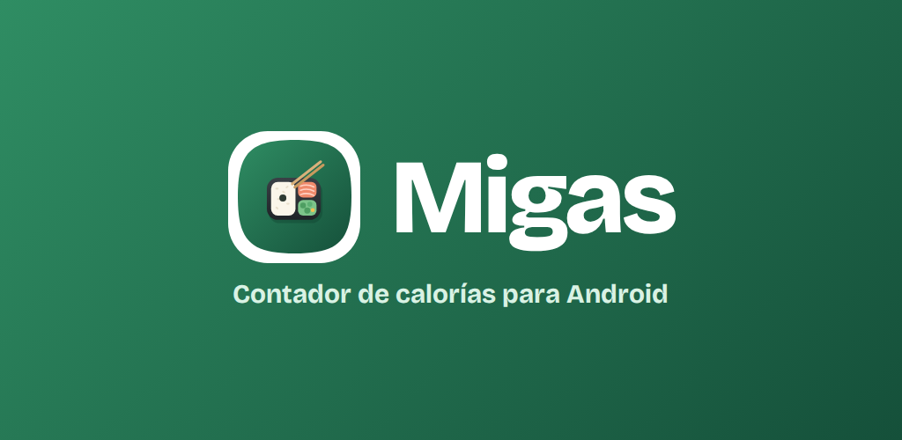
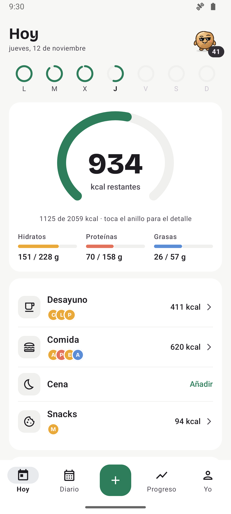
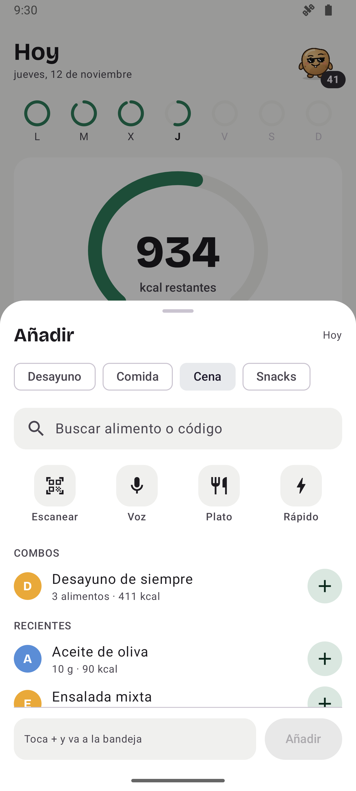
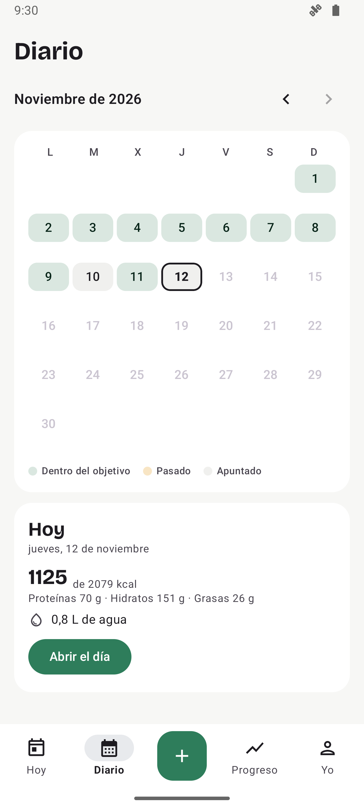
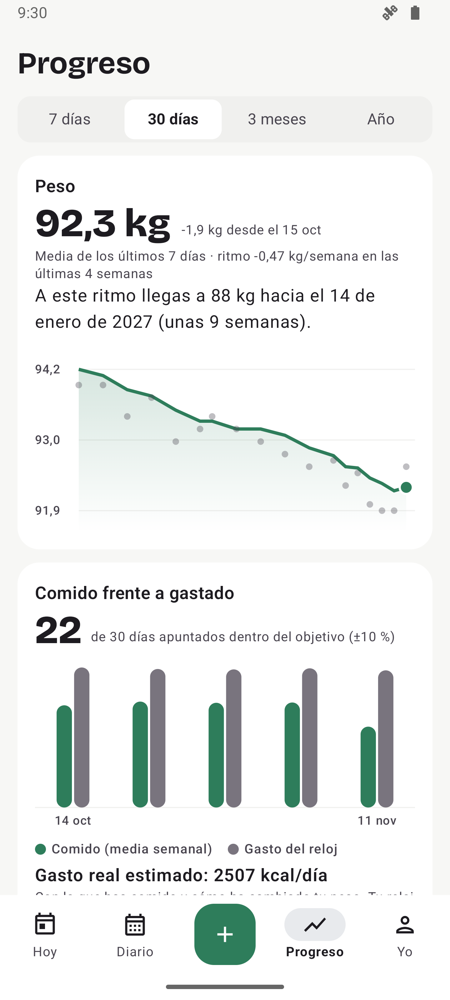

<p align="center"></p>

**Contador de calorías para Android, gratuito.** Sin cuentas, sin servidor y sin anuncios: tus datos se quedan
en tu móvil. Funciona con tu reloj a través de Health Connect. En castellano e inglés.

*A free calorie counter for Android. No accounts, no server, no ads. In English and Spanish —
[English below](#english).*

<p align="center">
  
  
  
  
</p>

## Descargar

**[Última versión (APK)](../../releases/latest)** · Android 14 o superior.

Descarga `app-release.apk` e instálala permitiendo «orígenes desconocidos». Después, en la app:
**Yo → Ajustes → Health Connect** para conceder la lectura.

## Qué hace

- **Apuntar en segundos**: más de 3.500 alimentos básicos sin conexión (tabla CIQUAL) y productos de
  supermercado de Open Food Facts; escáner de código de barras, foto de la etiqueta, voz, añadir rápido solo con
  kcal, combos y recetas.
- **IA opcional** con tu propia clave (NanoGPT o Claude): foto del plato y frases libres.
- **Con tu reloj**: lee de Health Connect calorías, pasos, sueño, peso y entrenos de Garmin, Samsung Health,
  Fitbit, Mi Fitness, Zepp, Polar, Suunto, Coros, Withings, Oura y otras, y ajusta el objetivo con lo que gastas.
- **Progreso**: diario con calendario, tendencias de peso y comida, medidas con fotos y racha con mascota.
- **Tus datos**: importa tu diario o tu peso desde un CSV de otra app; exporta a CSV, JSON o PDF.

## Compilar

Con JDK 17 o superior y el SDK de Android:

```bash
./gradlew testDebugUnitTest assembleDebug
# APK: app/build/outputs/apk/debug/app-debug.apk
```

La build release se firma si existe `~/.android-keys/calorias.properties` (o la ruta de
`-Pcalorias.signingProps=...`); si no, sale sin firmar.

## Privacidad

Ningún dato de salud sale del móvil. Detalle en la [política de privacidad](privacidad.md).

## Licencia

Migas se publica bajo la **[PolyForm Noncommercial 1.0.0](LICENSE)**:

- ✅ Puedes usarla, estudiarla y modificarla para cualquier fin **no comercial** (uso personal, estudio, hobby,
  ONG, centros educativos).
- ❌ **No** se puede usar ni vender con fines comerciales sin permiso del autor.
- 📌 Si distribuyes la app o **cualquier parte del código**, incluye la licencia y la línea `Required Notice` del
  archivo [LICENSE](LICENSE), que menciona este proyecto.

Para un uso comercial, abre una incidencia y lo hablamos.

## Créditos y datos

- **Alimentos básicos**: Anses. *Table de composition nutritionnelle des aliments Ciqual 2025*
  ([ciqual.anses.fr](https://ciqual.anses.fr)), bajo Licence Ouverte / Etalab 2.0. Valores tal como se publican;
  nombres traducidos al castellano para esta app. Cómo se genera: [`datos/alimentos/`](datos/alimentos).
- **Básicos que no están en CIQUAL**: [USDA FoodData Central](https://fdc.nal.usda.gov) (SR Legacy), dominio
  público.
- **Productos de supermercado**: contiene datos de [Open Food Facts](https://world.openfoodfacts.org),
  disponibles bajo la [Open Database License (ODbL)](https://opendatacommons.org/licenses/odbl/1-0/).
- **Tipografía**: [Bricolage Grotesque](https://github.com/ateliertriay/bricolage), SIL Open Font License.

Las licencias de los datos y de la tipografía son las de sus autores; la licencia de Migas cubre el código.

---

## English

**Migas** is a free calorie counter for Android. No accounts, no server, no ads: your data stays on your phone.

- **Download**: [latest release (APK)](../../releases/latest), Android 14+. The app follows the system language,
  or pick it in **Me → Settings → Language**.
- **Log in seconds**: over 3,500 offline basic foods (CIQUAL table) and Open Food Facts products; barcode
  scanner, nutrition label photo, voice, quick add with just kcal, combos and recipes.
- **Optional AI** with your own key (NanoGPT or Claude): plate photos and free sentences.
- **Works with your watch**: reads calories, steps, sleep, weight and workouts from Health Connect (Garmin,
  Samsung Health, Fitbit, Mi Fitness, Zepp, Polar, Suunto, Coros, Withings, Oura and more) and adapts your goal.
- **Your data**: import your diary or weight from another app's CSV; export to CSV, JSON or PDF.

**License**: [PolyForm Noncommercial 1.0.0](LICENSE). Free for any non-commercial use; commercial use needs the
author's permission. If you distribute the app or any part of its code, keep the license and its
`Required Notice` line. Food data: CIQUAL 2025 by Anses (Licence Ouverte / Etalab 2.0), USDA FoodData Central
(public domain) and Open Food Facts (ODbL).
